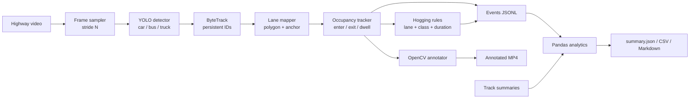

# Intelligent Highway Lane Occupancy & Hogging Detection

Computer-vision prototype for highway/toll-road footage: detect and classify vehicles
with a pretrained YOLO model, keep identities with ByteTrack, map each vehicle to a
configured lane polygon, measure lane occupancy duration, and emit **rule-based lane
hogging indications** plus lane-change events.

The project is designed to run in **Google Colab** (CPU or GPU) and to export
append-friendly JSONL that can be consumed by a real-time data pipeline.


*Synthetic demo: three lane polygons, per-vehicle lane/dwell labels, lane-change and
hogging counters. The demo runs without YOLO or PyTorch.*

## Highlights

- **Vehicle detection & classification** with pretrained Ultralytics YOLO
  (`yolo11n.pt` by default), filtered to `car`, `bus`, and `truck`.
- **Persistent tracking** with ByteTrack, exposed as run-scoped tracking IDs.
- **Polygon lane mapping** in normalized coordinates, so one config works at any
  resolution.
- **Lane occupancy analysis**: current lane, entry/exit time, dwell duration, and
  per-track lane history.
- **Hysteresis** (`min_lane_frames`) so a vehicle straddling a painted divider does not
  generate flickering lane changes.
- **Configurable lane-hogging rules** by lane, lane role, vehicle class, and minimum
  dwell time. Usage that does not match a rule remains "allowed usage".
- **Structured events** for lane entry, lane exit, lane change, and hogging indication.
- **Reports** for lane usage by class, lane changes, dwell statistics, and hogging
  indications (JSON, CSV, Markdown).
- **Annotated video** with lane polygons, boxes, IDs, class, lane, dwell time, and
  hogging status.
- **Offline synthetic demo** that exercises the complete pipeline without YOLO,
  PyTorch, or a video download.
- **Robust HLS/HTTP recorder** for capturing a fixed-length clip from a public CCTV
  stream in Colab.

## Architecture



See [docs/ARCHITECTURE.md](docs/ARCHITECTURE.md) for the lane assignment and event
logic, and [docs/LANE_RULES.md](docs/LANE_RULES.md) for rule design guidance.

## Quickstart

Requirements: Python 3.10+ and pip.

### Option A - run in Google Colab (recommended)

Open [`notebooks/colab_lane_occupancy.ipynb`](notebooks/colab_lane_occupancy.ipynb) and
run the cells from top to bottom. The notebook:

1. optionally checks the Colab GPU,
2. installs Ultralytics and the project,
3. mounts Google Drive and selects a video,
4. optionally records a clip from a public toll-road CCTV HLS stream,
5. writes lane polygons into `config/config.yaml`,
6. renders a lane preview image for calibration,
7. runs YOLO + ByteTrack,
8. plays the annotated video, shows the Markdown report, and copies outputs to Drive.

Colab already ships CUDA-enabled PyTorch, so do **not** install a CPU torch wheel there.
CPU inference also works: set `model.device: cpu`, `video.frame_stride: 2` or `3`, and
optionally `model.imgsz: 480`.

### Option B - offline synthetic demo (no YOLO, ~1 minute)

```powershell
python -m venv .venv
.\.venv\Scripts\Activate.ps1          # macOS/Linux: source .venv/bin/activate
pip install -r requirements-demo.txt
pip install -e . --no-deps
lane-analytics demo
```

Outputs are written to `output/demo/`:

```text
output/demo/
  input/demo_input.mp4
  input/demo_input.manifest.jsonl
  demo_annotated.mp4
  demo_events.jsonl
  demo_tracks.jsonl
  preview.jpg
  reports/
    summary.json  summary.md  events.csv  vehicles.csv
    lane_stints.csv  lane_usage.csv  lane_changes.csv
    hogging_events.csv  event_intervals.csv  run_config.json
```

The synthetic scene includes lane changes and a truck that stays in the overtaking lane,
so lane-change and hogging paths are exercised.

### Option C - real footage with YOLO + ByteTrack

```powershell
pip install torch torchvision --index-url https://download.pytorch.org/whl/cpu
pip install -e .
lane-analytics doctor
```

1. Put a clip at `data/raw/traffic.mp4` (or pass `--video`).
2. Draw the lane polygons against a frame:

   ```powershell
   lane-analytics preview-lanes --video data/raw/traffic.mp4 --frame 0
   # inspect output/lane_preview.jpg, then edit config/config.yaml
   ```

3. Run the analysis:

   ```powershell
   lane-analytics analyze --video data/raw/traffic.mp4
   ```

   For a CPU test, cap the run:

   ```powershell
   lane-analytics analyze --max-frames 300 --frame-stride 3 --no-video
   ```

The first YOLO run downloads `yolo11n.pt` automatically. Use `--model yolov8n.pt` for a
different checkpoint, or pass local weights.

## Configuration

All runtime settings live in [`config/config.yaml`](config/config.yaml). Coordinates are
**normalized** (`0.0 - 1.0`) so the same lane polygons work at any resolution.

### Lanes

A lane is a polygon plus metadata used by rules and reports:

```yaml
lanes:
  - name: lane_left
    index: 1
    direction: northbound
    role: normal
    polygon: [[0.08, 0.10], [0.34, 0.10], [0.34, 0.96], [0.08, 0.96]]

  - name: lane_center
    index: 2
    direction: northbound
    role: normal
    polygon: [[0.345, 0.10], [0.60, 0.10], [0.60, 0.96], [0.345, 0.96]]

  - name: lane_right
    index: 3
    direction: northbound
    role: overtaking
    polygon: [[0.605, 0.10], [0.88, 0.10], [0.88, 0.96], [0.605, 0.96]]
```

`role` is a free label (`normal`, `overtaking`, `restricted`, ...). Rules can target a
lane by name or by role. Polygons may overlap; when several contain the anchor point, the
smallest area wins.

### Lane assignment

```yaml
occupancy:
  anchor: bottom_center        # center | bottom_center | bottom_left | bottom_right | top_center
  min_confidence: 0.30
  min_lane_frames: 2           # consecutive observations before a switch is committed
  max_track_age_frames: 90
  emit_lane_enter: true
  emit_lane_exit: true
  emit_lane_change: true
```

`bottom_center` (the tyre/road contact point) is the safest default for perspective
camera views. Use `center` for a straight top-down view.

### Lane-hogging rules

```yaml
hogging:
  enabled: true
  retrigger_after_seconds: 0   # 0 = one indication per (track, lane stint, rule)
  rules:
    - name: heavy_vehicle_in_overtaking_lane
      lane_roles: [overtaking]
      classes: [truck, bus]
      min_dwell_seconds: 3.0
      severity: high
      description: "Truk/bus menggunakan lajur overtaking melebihi batas waktu."

    - name: prolonged_overtaking_lane
      lane_roles: [overtaking]
      classes: [car]
      min_dwell_seconds: 12.0
      severity: medium
      description: "Mobil bertahan di lajur overtaking melebihi batas waktu."
```

Each rule selects lanes by `lanes` **or** `lane_roles`, optionally filters classes, and
triggers once a vehicle has stayed continuously in a matching lane for at least
`min_dwell_seconds`. A rule that does not match is allowed usage. The output is an
**indication**, not a legal enforcement decision. See
[docs/LANE_RULES.md](docs/LANE_RULES.md).

### CPU settings

| Setting | Effect |
| --- | --- |
| `video.frame_stride: 2` | Process every 2nd frame; roughly halves inference cost. |
| `video.frame_stride: 3` | Faster still; dwell timing remains based on source FPS. |
| `model.imgsz: 480` | Faster inference, fewer small-object detections. |
| `model.weights: yolo11n.pt` | Smallest/fastest pretrained model in the family. |
| `--no-video` | Skip annotation for maximum data throughput. |
| `model.device: cpu` | Force CPU; set `0` for the first CUDA GPU. |

With `frame_stride > 1`, dwell time is still computed from source timestamps
(`frame_index / source_fps`), not from the number of processed frames.

## Outputs

Every run produces a run ID (`<camera_id>_<timestamp>`):

```text
output/
  videos/<run_id>_annotated.mp4
  events/<run_id>.jsonl
  tracks/<run_id>.jsonl
  reports/<run_id>/
    events.csv
    vehicles.csv
    lane_stints.csv
    lane_usage.csv
    lane_changes.csv
    hogging_events.csv
    event_intervals.csv
    summary.json
    summary.md
    run_config.json
```

A lane-hogging event:

```json
{
  "camera_id": "tmj_km486_500",
  "timestamp": "2026-11-07T08:00:12",
  "track_id": 12,
  "object_class": "truck",
  "confidence": 0.88,
  "event_type": "lane_hogging_indication",
  "lane_name": "lane_right",
  "lane_index": 3,
  "lane_role": "overtaking",
  "previous_lane": "",
  "dwell_seconds": 4.2,
  "severity": "high",
  "rule_name": "heavy_vehicle_in_overtaking_lane",
  "message": "Truk/bus menggunakan lajur overtaking melebihi batas waktu.",
  "frame_index": 120,
  "video_time_s": 12.0,
  "schema_version": "1.0",
  "event_id": "73db63605edc4a948e2c89581fbb6525"
}
```

The first seven fields plus `lane_name` form the stable contract; the rest add
traceability. See [docs/DATA_SCHEMA.md](docs/DATA_SCHEMA.md) and
[docs/schema/lane_event.schema.json](docs/schema/lane_event.schema.json).

## CLI

| Command | Purpose |
| --- | --- |
| `lane-analytics analyze` | Run detection, tracking, lane analysis, annotation, reports. |
| `lane-analytics demo` | Generate and process a synthetic multi-lane scene offline. |
| `lane-analytics preview-lanes` | Draw configured lane polygons on one frame. |
| `lane-analytics summarize <events.jsonl>` | Rebuild reports from existing JSONL. |
| `lane-analytics record` | Record a live HLS/HTTP stream for a fixed duration. |
| `lane-analytics doctor` | Show dependency and environment status. |

Run `lane-analytics <command> --help` for all options.

## Project structure

```text
highway-lane-occupancy/
├── config/config.yaml          # camera, model, lane, occupancy, and rule settings
├── data/                       # raw/processed media (gitignored)
├── docs/
│   ├── ARCHITECTURE.md
│   ├── DATA_SCHEMA.md
│   ├── LANE_RULES.md
│   ├── RUNBOOK.md
│   ├── schema/lane_event.schema.json
│   └── sample_output/          # committed synthetic demo artifacts
├── notebooks/colab_lane_occupancy.ipynb
├── src/lane_analytics/
│   ├── config.py               # typed YAML config + validation
│   ├── geometry.py             # polygon math and lane assignment
│   ├── detector.py             # YOLO + ByteTrack backend
│   ├── lane_tracker.py         # occupancy, dwell, transitions, events
│   ├── hogging.py              # configurable rule matching
│   ├── annotator.py            # OpenCV rendering
│   ├── analytics.py            # Pandas summaries and reports
│   ├── pipeline.py             # orchestration
│   ├── demo.py                 # synthetic scene + manifest backend
│   ├── recorder.py             # live HLS/HTTP recorder
│   └── cli.py
├── tests/
├── requirements.txt            # full runtime
├── requirements-demo.txt       # demo only
└── pyproject.toml
```

## How it works

1. **Sample** every Nth source frame to control CPU cost while retaining source timing.
2. **Detect + track** with `model.track(..., persist=True, tracker="bytetrack.yaml")`.
3. **Map to lane**: take the vehicle anchor (`bottom_center` by default), normalize it,
   and test it against the configured polygons.
4. **Stabilize**: only commit a lane assignment after `min_lane_frames` consecutive
   observations, preventing boundary flicker.
5. **Measure**: keep one open lane stint per track. Closing a stint records exit time and
   dwell duration.
6. **Emit** `lane_enter`, `lane_exit`, and `lane_change` events immediately to JSONL.
7. **Evaluate rules** on each stable observation. A matching rule fires once its
   `min_dwell_seconds` is reached, subject to `retrigger_after_seconds`.
8. **Finalize** open stints at the last observation (or when a track becomes stale), write
   per-track summaries, and build CSV/JSON/Markdown reports with Pandas.

Detailed notes: [docs/ARCHITECTURE.md](docs/ARCHITECTURE.md).

## Testing

```powershell
pip install -e ".[dev]"
pytest
```

The suite covers point-in-polygon geometry, overlap resolution, config validation, lane
entry/exit/change, flicker suppression, hogging thresholds, retriggering, schema
validation, and an end-to-end synthetic demo run.

## Limitations

- Designed for prerecorded files; the recorder can capture a live stream into a file first.
- Lane polygons are manual. They must be calibrated per camera and do not follow a
  changing perspective automatically.
- Lane assignment is a point test, not a segmentation mask. A vehicle straddling a
  divider is assigned using its anchor and hysteresis.
- No speed estimation yet. Hogging rules use dwell time, class, and lane, not relative
  speed or actual overtaking behaviour.
- ByteTrack can switch IDs after long occlusions, which may split one vehicle into
  multiple track summaries.
- Rule thresholds are heuristic and must be reviewed against the road's actual rules.
- Accuracy and throughput depend on the YOLO checkpoint, resolution, frame stride, and
  footage quality.

## Downstream integration

The JSONL event stream is append-friendly: each event has an `event_id`, a stable
`camera_id`, an ISO timestamp, and a documented `event_type`. A data pipeline can ingest
line by line, validate against the JSON Schema, deduplicate by `event_id`, partition by
camera/date, and aggregate lane usage or hogging indications. See
[docs/DATA_SCHEMA.md](docs/DATA_SCHEMA.md).

## Data sources

Use footage you have the right to process. Public options include Pexels/Pixabay traffic
clips, Kaggle vehicle-counting datasets, and research datasets such as UA-DETRAC (respect
each dataset's license). Keep raw media out of version control. The Colab notebook
includes an optional recorder for public toll-road CCTV streams; use it responsibly and
avoid aggressive requests.

## License

MIT for this repository's code. Pretrained YOLO weights and Ultralytics are distributed
under their own licenses (Ultralytics YOLO is AGPL-3.0 unless covered by an enterprise
license); review those terms before redistribution or commercial use.
