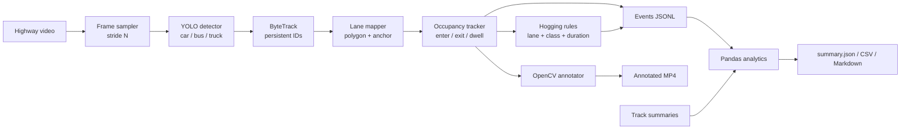

# Intelligent Highway Lane Occupancy & Hogging Detection

Computer-vision prototype for highway/toll-road footage: detect and classify vehicles
with a pretrained YOLO model, keep identities with ByteTrack, map each vehicle to a
configured lane polygon, measure lane occupancy duration, and emit **rule-based lane
hogging indications** plus lane-change events.

The project is designed to run in **Google Colab** (CPU or GPU) and to export
append-friendly JSONL that can be consumed by a real-time data pipeline.

The repository ships a **calibrated profile** for a real night-time toll-road camera
(Tj. Priok, KM 58+400 B, 1024x768 @ 18 fps): six lanes across both carriageways, with the
median-side lane marked as the overtaking lane in each direction. Recalibrate the polygons
for any other camera with `lane-analytics calibrate`.


*Synthetic demo: three lane polygons, per-vehicle lane/dwell labels, lane-change and
hogging counters. The demo runs without YOLO or PyTorch.*

## Highlights

- **Vehicle detection & classification** with pretrained Ultralytics YOLO
  (`yolo11n.pt` by default), filtered to `car`, `bus`, and `truck`.
- **Persistent tracking** with ByteTrack, exposed as run-scoped tracking IDs.
- **Polygon lane mapping** in normalized coordinates, so one config works at any
  resolution.
- **Lane occupancy analysis**: current lane, entry/exit time, dwell duration, and
  per-track lane history.
- **Hysteresis** (`min_lane_frames`) so a vehicle straddling a painted divider does not
  generate flickering lane changes.
- **Configurable lane-hogging rules** by lane, lane role, vehicle class, and minimum
  dwell time. Usage that does not match a rule remains "allowed usage".
- **Structured events** for lane entry, lane exit, lane change, and hogging indication.
- **Reports** for lane usage by class, lane changes, dwell statistics, and hogging
  indications (JSON, CSV, Markdown).
- **Annotated video** with lane polygons, boxes, IDs, class, lane, dwell time, and
  hogging status.
- **Offline synthetic demo** that exercises the complete pipeline without YOLO,
  PyTorch, or a video download.
- **Robust HLS/HTTP recorder** for capturing a fixed-length clip from a public CCTV
  stream in Colab.

## Architecture



See [docs/ARCHITECTURE.md](docs/ARCHITECTURE.md) for the lane assignment and event
logic, and [docs/LANE_RULES.md](docs/LANE_RULES.md) for rule design guidance.

## Quickstart

Requirements: Python 3.10+ and pip.

### Option A - run in Google Colab (batch + webhook replay)

Open [`notebooks/colab_lane_occupancy.ipynb`](notebooks/colab_lane_occupancy.ipynb). The
notebook is intentionally short; it only clones the repo, installs the package, and calls one
activation function.

Pick one source:

| `source` | Input | What happens |
| --- | --- | --- |
| `"drive_zip"` | Public Google Drive zip/folder with the clips | Download, extract, process every clip |
| `"live"` | HLS URL (default: the Semarang-Solo camera) | Record `record_seconds`, then process |

```python
from lane_analytics.colab import activate

# 12 clips in a Drive zip
activate(
    source="drive_zip",
    drive_url="https://drive.google.com/file/d/XXXX/view?usp=sharing",
    base_timestamp="2026-11-07T23:00:00",   # optional; clips are chained by duration
    webhook_url="https://xxxx.ngrok-free.app",
    webhook_token="same-as-WEBHOOK_TOKEN",
    speed=5,            # 1 = real time, 5 = 5x faster
    window_seconds=5,   # micro-batch size in event-time seconds
)

# Live stream
activate(
    source="live",
    record_seconds=300,
    webhook_url="https://xxxx.ngrok-free.app",
    webhook_token="same-as-WEBHOOK_TOKEN",
    speed=1,
)
```

`activate` runs the normal batch pipeline (`analyze`). Because evidence is enabled by default,
it renders the annotated video so snapshots and clips show the detection boxes; pass
`write_video=False` to skip rendering (evidence then uses the source video). After the batch it
replays each run: events per window → `/webhook`, tracks once → `/webhook/tracks`, and run
metadata with `complete: true` → `/webhook/run`. The webhook receiver, Kafka, pipeline, and
dashboard belong to the separate pipeline project; this repo only sends.

Useful parameters: `max_videos`, `device` (`"0"` on GPU), `imgsz`, `frame_stride`,
`max_frames`, `base_timestamps={"clip01.mp4": "..."}`, `write_video=False`, `replay=False`,
`dry_run=True`.

Colab already ships CUDA-enabled PyTorch, so do **not** install a CPU torch wheel there.
CPU inference also works: keep `model.device: cpu`, and if throughput matters more than
latency you can raise `video.frame_stride` to 2 or 3 (fast near-field vehicles then take
longer to get their first box) and optionally lower `model.imgsz` to 640.

### Option B - offline synthetic demo (no YOLO, ~1 minute)

```powershell
python -m venv .venv
.\.venv\Scripts\Activate.ps1          # macOS/Linux: source .venv/bin/activate
pip install -r requirements-demo.txt
pip install -e . --no-deps
lane-analytics demo
```

Outputs are written to `output/demo/`:

```text
output/demo/
  input/demo_input.mp4
  input/demo_input.manifest.jsonl
  demo_annotated.mp4
  demo_events.jsonl
  demo_tracks.jsonl
  preview.jpg
  reports/
    summary.json  summary.md  events.csv  vehicles.csv
    lane_stints.csv  lane_usage.csv  lane_changes.csv
    hogging_events.csv  event_intervals.csv  run_config.json
```

The synthetic scene includes lane changes and a truck that stays in the overtaking lane,
so lane-change and hogging paths are exercised.

### Option C - real footage with YOLO + ByteTrack

```powershell
pip install torch torchvision --index-url https://download.pytorch.org/whl/cpu
pip install -e .
lane-analytics doctor
```

1. Put a clip at `data/raw/km58_400B_tj_priok_20261107_161545.mp4` (the shipped profile),
   or pass `--video` for another file.
2. Check the calibration against a real frame:

   ```powershell
   lane-analytics calibrate --frame 2160
   # output/calibration/grid.jpg: pixel grid + normalized y ruler + current polygons
   lane-analytics preview-lanes --frame 2160
   # inspect output/lane_preview.jpg, then edit config/config.yaml if needed
   ```

3. Run the analysis:

   ```powershell
   lane-analytics analyze --video data/raw/km58_400B_tj_priok_20261107_161545.mp4
   ```

   For a CPU test, cap the run:

   ```powershell
   lane-analytics analyze --max-frames 1080 --no-video
   ```

The first YOLO run downloads `yolo11n.pt` automatically. Use `--model yolov8n.pt` for a
different checkpoint, or pass local weights.

## Configuration

All runtime settings live in [`config/config.yaml`](config/config.yaml). Coordinates are
**normalized** (`0.0 - 1.0`) so the same lane polygons work at any resolution.

### Camera profile (Tj. Priok KM 58+400 B)


The camera sits on the median, so both carriageways are visible. Six lanes are mapped,
three per direction:

| lanes | direction | role |
| --- | --- | --- |
| `nb_lane_1`, `nb_lane_2`, `nb_lane_3` | northbound (left carriageway, traffic receding) | normal, normal, `overtaking` |
| `sb_lane_1`, `sb_lane_2`, `sb_lane_3` | southbound (right carriageway, traffic approaching) | normal, normal, `overtaking` |

`lane_3` is the median-side lane in both directions, so the hogging rules target it through
the `overtaking` role.

The polygons were drawn on a **1434x1076** capture as eight boundary polylines (left edge,
three dividers, right edge per direction) and normalized by that size. The capture has the
same 4:3 aspect ratio as the 1024x768 recording, so the same normalized coordinates apply
to the video. Each lane is built as `boundary[i] + reversed(boundary[i+1])`; the small
corner triangles at the bottom-left and bottom-right between `lane1_2` and `lane2_3` are
assigned to lane 2.

The complete definition is in [`config/config.yaml`](config/config.yaml).

**Measured on the 5-minute sample** (YOLO11n, CPU, `frame_stride: 2`, `imgsz: 960`):

| Metric | Value |
| --- | --- |
| Tracked vehicles | 219 (163 car, 43 truck, 13 bus) |
| Lane stints / lane changes | 86 / 12 |
| Hogging indications | 8 (7 medium, 1 high) |
| Throughput | ~8 fps (2728 processed frames in 5m37s) |

That table is the stride-2 batch run. The default is now `frame_stride: 1` so a fast
near-field vehicle gets its first box on the next frame instead of waiting for ByteTrack
to re-confirm it.

### Recalibrating for another camera

```powershell
lane-analytics calibrate --video data/raw/other-camera.mp4 --frame 0
```

This writes `output/calibration/grid.jpg` with a pixel grid and a normalized ruler. Read
each lane edge at two heights, divide `x` by the frame width and `y` by the frame height,
and replace the polygons in `config/config.yaml`. Repeat until the polygon edges sit on the
painted lines.

You can draw the coordinates on any capture of the camera as long as it has the same aspect
ratio as the recording; only the normalized values are stored.

### Lane assignment

```yaml
occupancy:
  anchor: bottom_center             # fallback: center | bottom_center | bottom_left | ...
  anchor_shift_enabled: true        # slide wide near-field boxes to the outer corner
  anchor_shift_small_bbox_px: 90    # no shift at or below this box width
  anchor_shift_large_bbox_px: 250   # full shift at or above this width
  direction_deadband_px: 2.0        # vertical motion needed to count as a direction vote
  direction_min_votes: 2            # consistent votes before the direction is locked
  min_confidence: 0.30
  min_lane_frames: 3                # consecutive observations before a switch is committed
  max_track_age_frames: 36
  emit_lane_enter: true
  emit_lane_exit: true
  emit_lane_change: true
```

`bottom_center` (the tyre/road contact point) is the safest default for perspective
camera views. Use `center` for a straight top-down view.

**Adaptive anchor for wide boxes.** With a high, oblique camera a near-field box can be
wider than a lane, so its bottom-centre can land on the wrong side of a painted divider.
When `anchor_shift_enabled` is on, the anchor slides from the bottom-centre toward the
**outer bottom corner** as the box widens:

- northbound (receding) traffic slides toward the **bottom-left** corner,
- southbound (approaching) traffic slides toward the **bottom-right** corner.

The direction comes from the track's vertical motion: receding vehicles move up
(`y` decreasing), approaching vehicles move down. It is locked after
`direction_min_votes` consistent observations, so a one-frame box jitter cannot flip it.
The slide is linear between `anchor_shift_small_bbox_px` and
`anchor_shift_large_bbox_px`. The anchor point is drawn as a small white dot inside each
box in the annotated video, so you can verify it.

### Lane-hogging rules

```yaml
hogging:
  enabled: true
  retrigger_after_seconds: 0   # 0 = one indication per (track, lane stint, rule)
  rules:
    - name: heavy_vehicle_in_overtaking_lane
      lane_roles: [overtaking]
      classes: [truck, bus]
      min_dwell_seconds: 0.4
      severity: high
      description: "Truk/bus berada di lajur cepat (median) - indikasi pelanggaran lajur."

    - name: prolonged_overtaking_lane
      lane_roles: [overtaking]
      classes: [car]
      min_dwell_seconds: 2.0
      severity: medium
      description: "Mobil bertahan di lajur cepat (median) hampir sepanjang lintasan pandang."
```

**These thresholds are specific to this camera.** The analysis zone covers the visible
stretch in each direction, so dwell ranges from ~0.1 s to ~7 s depending on lane and
direction. On the five-minute sample the overtaking lanes measured:

| lane | class | dwell range | median |
| --- | --- | --- | --- |
| `nb_lane_3` | car | 0.56-3.00 s | ~2.0 s |
| `nb_lane_3` | truck | 0.22-0.44 s | 0.33 s |
| `sb_lane_3` | car | 0.33-2.78 s | ~1.0 s |
| `sb_lane_3` | truck | 0.33-0.45 s | 0.39 s |

The 2.0 s car threshold therefore flags the tail (roughly the upper third of overtaking-lane
passes), not the majority. A camera with a longer view needs proportionally larger
thresholds. See [docs/LANE_RULES.md](docs/LANE_RULES.md) for the calibration procedure.

Each rule selects lanes by `lanes` **or** `lane_roles`, optionally filters classes, and
triggers once a vehicle has stayed continuously in a matching lane for at least
`min_dwell_seconds`. A rule that does not match is allowed usage. The output is an
**indication**, not a legal enforcement decision.

### CPU settings

| Setting | Effect |
| --- | --- |
| `video.frame_stride: 1` | Detect on every frame (default). Lowest latency; a fast vehicle near the camera gets its first box on the next frame. |
| `video.frame_stride: 2` | Process every 2nd frame (~9 fps from the 18 fps source). ~2x faster, but ByteTrack can need up to ~0.7 s longer to confirm fast near-field vehicles. |
| `video.frame_stride: 3` | Faster still; dwell timing remains based on source FPS. |
| `model.imgsz: 960` | Default: near-native for 1024x768, catches small distant vehicles. |
| `model.imgsz: 640` | ~2x faster, but loses some far-field detections. |
| `model.weights: yolo11n.pt` | Smallest/fastest pretrained model in the family. |
| `--no-video` | Skip annotation for maximum data throughput. |
| `model.device: cpu` | Force CPU; set `0` for the first CUDA GPU. |

With `frame_stride > 1`, dwell time is still computed from source timestamps
(`frame_index / source_fps`), not from the number of processed frames.

## Outputs

Every run produces a run ID (`<camera_id>_<timestamp>`):

```text
output/
  videos/<run_id>_annotated.mp4
  events/<run_id>.jsonl
  tracks/<run_id>.jsonl
  reports/<run_id>/
    events.csv
    vehicles.csv
    lane_stints.csv
    lane_usage.csv
    lane_changes.csv
    hogging_events.csv
    event_intervals.csv
    summary.json
    summary.md
    run_config.json
  evidence/<run_id>/
    index.json                 # event -> snapshot + clip mapping
    snapshots/snap_*.jpg       # one frame at the event
    clips/clip_*.mp4           # 8 s around the event (4 s before + 4 s after)
```

### Evidence snapshots and clips

When `evidence.enabled` is true (the default), each run also writes a snapshot and a short
annotated clip for every event. Events that share a frame (the `lane_exit` →
`lane_change` → `lane_enter` sequence) share one file, so nothing is duplicated.

`evidence/index.json` maps every event to its media:

```json
{
  "event_id": "...",
  "event_type": "lane_hogging_indication",
  "track_id": 2,
  "object_class": "car",
  "lane_name": "sb_lane_3",
  "timestamp": "2026-11-08T06:58:12",
  "video_time_s": 6.687,
  "frame_index": 120,
  "severity": "medium",
  "rule_name": "prolonged_overtaking_lane",
  "snapshot": "snapshots/snap_000120.jpg",
  "clip": "clips/clip_000120.mp4",
  "clip_start_s": 2.687,
  "clip_end_s": 10.687,
  "clip_duration_s": 8.0
}
```

Paths are relative to `output/evidence/<run_id>/`. For a dashboard, prefix them with the media
base URL (or serve that directory as static files). Snapshots and clips are cut from the
annotated video, so they show the box, lane label, and hogging badge.

Tune it in `config/config.yaml`:

```yaml
evidence:
  enabled: true
  event_types: []          # [] = all events; or [lane_change, lane_hogging_indication]
  before_seconds: 4.0
  after_seconds: 4.0
  snapshot_format: jpg
  snapshot_quality: 92
  clip_codec: libx264
  clip_preset: veryfast
  clip_crf: 23
  max_clips: null
  output_dir: null         # default output/evidence/<run_id>
```

Backfill evidence for a run that was processed before this feature:

```powershell
lane-analytics evidence --run-id km58_20261108_065806
```

If the run used `--start-frame`, the command reads the offset from
`reports/<run_id>/summary.json`; override it with `--time-offset` if needed. Disable evidence
for one run with `lane-analytics analyze --no-evidence`.

A lane-hogging event (real output from the sample clip):

```json
{
  "camera_id": "tj_priok_km58_400b",
  "timestamp": "2026-11-07T23:17:16",
  "track_id": 433,
  "object_class": "truck",
  "confidence": 0.4906,
  "event_type": "lane_hogging_indication",
  "lane_name": "sb_lane_3",
  "lane_index": 3,
  "lane_role": "overtaking",
  "previous_lane": "",
  "dwell_seconds": 0.445,
  "class_id": 7,
  "frame_index": 1776,
  "video_time_s": 98.656,
  "severity": "high",
  "rule_name": "heavy_vehicle_in_overtaking_lane",
  "message": "Truk/bus berada di lajur cepat (median) - indikasi pelanggaran lajur.",
  "schema_version": "1.0",
  "event_id": "ffb9d1f85d814b99894e6e02dbc4842d"
}
```

The first seven fields plus `lane_name` form the stable contract; the rest add
traceability. See [docs/DATA_SCHEMA.md](docs/DATA_SCHEMA.md) and
[docs/schema/lane_event.schema.json](docs/schema/lane_event.schema.json).

## Webhook replay (simulated live feed)

Batch artifacts can be replayed to a local webhook as micro-batches, which simulates a
near-real-time feed for a separate data pipeline:

```powershell
lane-analytics replay `
  --events output/events/km58_162550_final.jsonl `
  --tracks output/tracks/km58_162550_final.jsonl `
  --summary output/reports/km58_162550_final/summary.json `
  --run-config output/reports/km58_162550_final/run_config.json `
  --url https://xxxx.ngrok-free.app `
  --token $env:WEBHOOK_TOKEN `
  --speed 1 `
  --window 5
```

The sender calls `GET /health` first, then posts events per 5-second event-time window,
tracks once, and finally run metadata with `complete: true`. It retries `429`/`5xx` and
network errors with exponential backoff. Use `--dry-run` to write the exact HTTP bodies to
`output/replay/<run_id>/` without a receiver.

The full transport contract (endpoints, payloads, topics) is in
[docs/HANDOFF_DATA_PIPELINE_DASHBOARD.md](docs/HANDOFF_DATA_PIPELINE_DASHBOARD.md#45-kontrak-webhook-transport-handoff).
This repository only sends; it has no receiver, Kafka client, pipeline, or dashboard.

## CLI

| Command | Purpose |
| --- | --- |
| `lane-analytics analyze` | Run detection, tracking, lane analysis, annotation, reports. |
| `lane-analytics calibrate` | Render a frame with a pixel/normalized grid for drawing lane polygons. |
| `lane-analytics preview-lanes` | Draw configured lane polygons on one frame. |
| `lane-analytics demo` | Generate and process a synthetic multi-lane scene offline. |
| `lane-analytics summarize <events.jsonl>` | Rebuild reports from existing JSONL. |
| `lane-analytics evidence` | Build snapshots + clips for an existing run. |
| `lane-analytics record` | Record a live HLS/HTTP stream for a fixed duration. |
| `lane-analytics replay` | Replay precomputed events to the webhook (simulated live feed). |
| `lane-analytics doctor` | Show dependency and environment status. |

Run `lane-analytics <command> --help` for all options.

## Project structure

```text
highway-lane-occupancy/
├── config/config.yaml          # camera, model, lane, occupancy, and rule settings
├── data/                       # raw/processed media (gitignored)
├── docs/
│   ├── ARCHITECTURE.md
│   ├── DATA_SCHEMA.md
│   ├── LANE_RULES.md
│   ├── RUNBOOK.md
│   ├── portfolio/              # CV + web handoff docs and media assets
│   ├── schema/lane_event.schema.json
│   └── sample_output/          # committed synthetic demo artifacts
├── notebooks/colab_lane_occupancy.ipynb
├── src/lane_analytics/
│   ├── config.py               # typed YAML config + validation
│   ├── geometry.py             # polygon math and lane assignment
│   ├── detector.py             # YOLO + ByteTrack backend
│   ├── lane_tracker.py         # occupancy, dwell, transitions, events
│   ├── hogging.py              # configurable rule matching
│   ├── annotator.py            # OpenCV rendering
│   ├── analytics.py            # Pandas summaries and reports
│   ├── pipeline.py             # orchestration
│   ├── evidence.py             # snapshots + short clips per event
│   ├── demo.py                 # synthetic scene + manifest backend
│   ├── recorder.py             # live HLS/HTTP recorder
│   ├── replay.py               # webhook sender: paced event micro-batches
│   ├── colab.py                # Colab activate(): Drive zip or live stream
│   └── cli.py
├── tests/
├── requirements.txt            # full runtime
├── requirements-demo.txt       # demo only
└── pyproject.toml
```

## How it works

1. **Sample** every Nth source frame to control CPU cost while retaining source timing.
2. **Detect + track** with `model.track(..., persist=True, tracker="bytetrack.yaml")`.
3. **Map to lane**: take the vehicle anchor (`bottom_center` by default, optionally
   sliding to the outer bottom corner for wide near-field boxes), normalize it, and test
   it against the configured polygons.
4. **Stabilize**: only commit a lane assignment after `min_lane_frames` consecutive
   observations, preventing boundary flicker.
5. **Measure**: keep one open lane stint per track. Closing a stint records exit time and
   dwell duration.
6. **Emit** `lane_enter`, `lane_exit`, and `lane_change` events immediately to JSONL.
7. **Evaluate rules** on each stable observation. A matching rule fires once its
   `min_dwell_seconds` is reached, subject to `retrigger_after_seconds`.
8. **Finalize** open stints at the last observation (or when a track becomes stale), write
   per-track summaries, and build CSV/JSON/Markdown reports with Pandas.

Detailed notes: [docs/ARCHITECTURE.md](docs/ARCHITECTURE.md).

## Testing

```powershell
pip install -e ".[dev]"
pytest
```

The suite covers point-in-polygon geometry, overlap resolution, config validation, lane
entry/exit/change, flicker suppression, hogging thresholds, retriggering, schema
validation, and an end-to-end synthetic demo run.

## Limitations

- Designed for prerecorded files; the recorder can capture a live stream into a file first.
- Lane polygons are manual. They must be calibrated per camera and do not follow a
  changing perspective automatically.
- **Short-baseline cameras limit dwell semantics.** The shipped profile covers only the
  visible stretch in each direction, so a vehicle is inside the polygons for roughly
  0.5-3 s at highway speed. Hogging thresholds are scaled to that window and mean "stayed
  in the lane for most of the visible pass".
- Lane assignment is a point test, not a segmentation mask. A vehicle straddling a
  divider is assigned using its anchor and hysteresis.
- The opposite carriageway is mapped with its own lanes and rules; `lane_index` is scoped
  per direction (both directions have a lane 1), so use `lane_name` as the stable key.
- No speed estimation yet. Hogging rules use dwell time, class, and lane, not relative
  speed or actual overtaking behaviour.
- ByteTrack can switch IDs after long occlusions, which may split one vehicle into
  multiple track summaries.
- Rule thresholds are heuristic and must be reviewed against the road's actual rules.
- Accuracy and throughput depend on the YOLO checkpoint, resolution, frame stride, and
  footage quality.

## Downstream integration

The JSONL event stream is append-friendly: each event has an `event_id`, a stable
`camera_id`, an ISO timestamp, and a documented `event_type`. A data pipeline can ingest
line by line, validate against the JSON Schema, deduplicate by `event_id`, partition by
camera/date, and aggregate lane usage or hogging indications. See
[docs/DATA_SCHEMA.md](docs/DATA_SCHEMA.md).

## Data sources

Use footage you have the right to process. Public options include Pexels/Pixabay traffic
clips, Kaggle vehicle-counting datasets, and research datasets such as UA-DETRAC (respect
each dataset's license). Keep raw media out of version control. The Colab notebook
includes an optional recorder for public toll-road CCTV streams; use it responsibly and
avoid aggressive requests.

## License

MIT for this repository's code. Pretrained YOLO weights and Ultralytics are distributed
under their own licenses (Ultralytics YOLO is AGPL-3.0 unless covered by an enterprise
license); review those terms before redistribution or commercial use.
