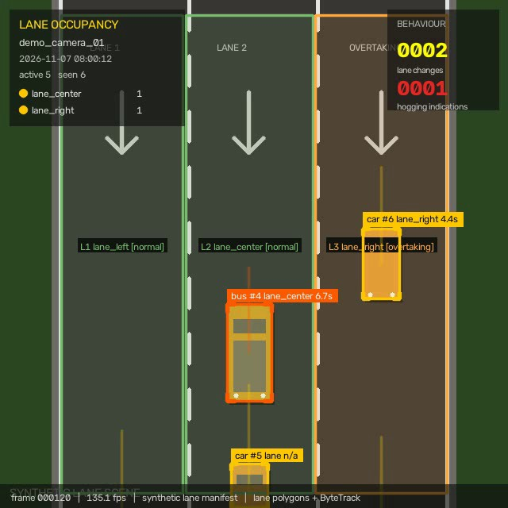
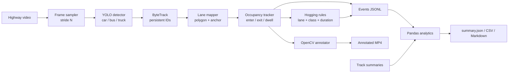
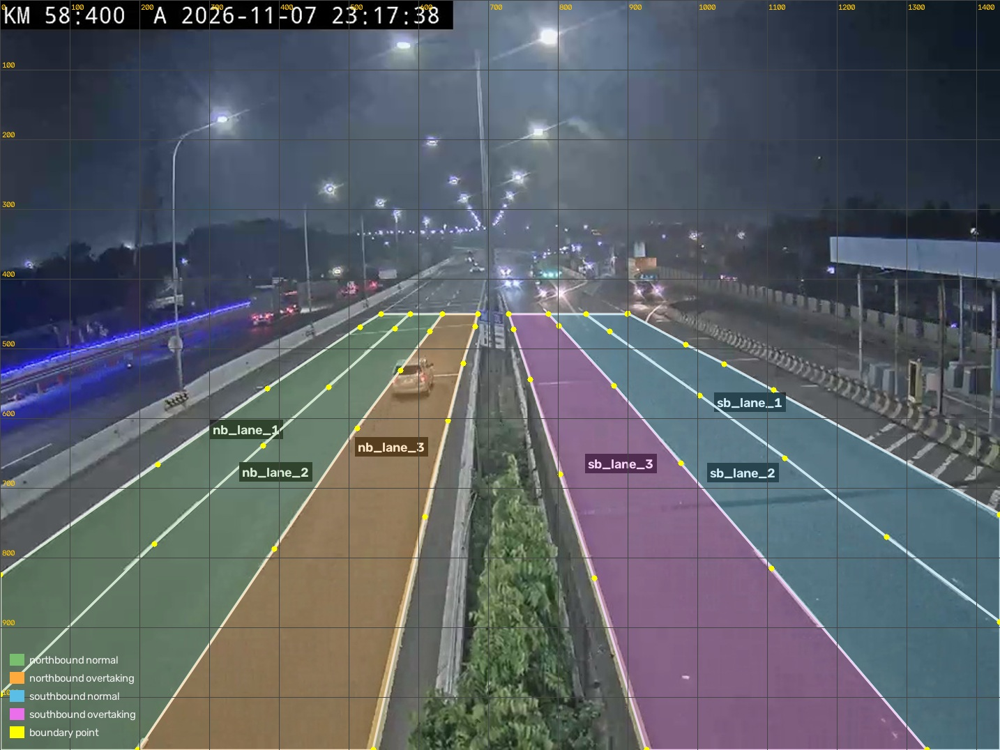

# Intelligent Highway Lane Occupancy & Hogging Detection

Computer-vision prototype for highway/toll-road footage: detect and classify vehicles
with a pretrained YOLO model, keep identities with ByteTrack, map each vehicle to a
configured lane polygon, measure lane occupancy duration, and emit **rule-based lane
hogging indications** plus lane-change events.

The project is designed to run in **Google Colab** (CPU or GPU) and to export
append-friendly JSONL that can be consumed by a real-time data pipeline.

The repository ships a **calibrated profile** for a real night-time toll-road camera
(Tj. Priok, KM 58+400 B, 1024x768 @ 18 fps): six lanes across both carriageways, with the
median-side lane marked as the overtaking lane in each direction. Recalibrate the polygons
for any other camera with `lane-analytics calibrate`.



*Synthetic demo: three lane polygons, per-vehicle lane/dwell labels, lane-change and
hogging counters. The demo runs without YOLO or PyTorch.*

## Highlights

- **Vehicle detection & classification** with pretrained Ultralytics YOLO
  (`yolo11n.pt` by default), filtered to `car`, `bus`, and `truck`.
- **Persistent tracking** with ByteTrack, exposed as run-scoped tracking IDs.
- **Parallel segmented processing** for long clips: overlapping workers hand tracks over
  with Hungarian assignment, so canonical IDs and lane events stay continuous across seams.
- **Polygon lane mapping** in normalized coordinates, so one config works at any
  resolution.
- **Lane occupancy analysis**: current lane, entry/exit time, dwell duration, and
  per-track lane history.
- **Hysteresis** (`min_lane_frames`) so a vehicle straddling a painted divider does not
  generate flickering lane changes.
- **Configurable lane-hogging rules** by lane, lane role, vehicle class, and minimum
  dwell time. Usage that does not match a rule remains "allowed usage".
- **Structured events** for lane entry, lane exit, lane change, and hogging indication.
- **Reports** for lane usage by class, lane changes, dwell statistics, and hogging
  indications (JSON, CSV, Markdown).
- **Annotated video** with lane polygons, boxes, IDs, class, lane, dwell time, and
  hogging status.
- **Offline synthetic demo** that exercises the complete pipeline without YOLO,
  PyTorch, or a video download.
- **Robust HLS/HTTP recorder** for capturing a fixed-length clip from a public CCTV
  stream in Colab.

## Architecture



See [docs/ARCHITECTURE.md](docs/ARCHITECTURE.md) for the lane assignment and event
logic, and [docs/LANE_RULES.md](docs/LANE_RULES.md) for rule design guidance.

## Quickstart

Requirements: Python 3.10+ and pip.

### Option A - run in Google Colab (batch + pipeline upload)

Open [`notebooks/colab_lane_occupancy.ipynb`](notebooks/colab_lane_occupancy.ipynb). The
notebook is intentionally short; it only clones the repo, installs the package, and calls one
activation function.

Pick one source:

| `source` | Input | What happens |
| --- | --- | --- |
| `"drive_zip"` | Public Google Drive zip/folder with the clips | Download, extract, process every clip |
| `"live"` | HLS URL (default: the Semarang-Solo camera) | Record `record_seconds`, then process |

```python
from lane_analytics.colab import activate

# 12 clips in a Drive zip. The token comes from the PIPELINE_WEBHOOK_TOKEN
# secret; the default target is the production Cloudflare tunnel.
activate(
    source="drive_zip",
    drive_url="https://drive.google.com/file/d/XXXX/view?usp=sharing",
    base_timestamp="2026-11-07T23:00:00",   # optional; clips are chained by duration
    speed=5,            # 1 = real time, 5 = 5x faster
    window_seconds=5,   # micro-batch size in event-time seconds
)

# Live stream
activate(
    source="live",
    record_seconds=300,
    speed=1,
)
```

`activate` runs the normal batch pipeline (`analyze`). Because evidence is enabled by default,
it renders the annotated video so snapshots and clips show the detection boxes; pass
`write_video=False` to skip rendering (evidence then uses the source video). After the batch it
sends each run to the pipeline: events per window → `/webhook`, tracks once → `/webhook/tracks`,
and run metadata with `complete: true` → `/webhook/run`. The receiver, Kafka, pipeline, and
dashboard belong to the separate pipeline project; this repo only sends.

Useful parameters: `max_videos`, `device` (`"0"` on GPU), `imgsz`, `frame_stride`,
`max_frames`, `base_timestamps={"clip01.mp4": "..."}`, `write_video=False`, `replay=False`,
`dry_run=True`, `webhook_url`, `webhook_token`.

See [docs/PIPELINE_CLOUDFLARE.md](docs/PIPELINE_CLOUDFLARE.md) for the Cloudflare address,
secrets, retry rules, and verification steps.

Colab already ships CUDA-enabled PyTorch, so do **not** install a CPU torch wheel there.
CPU inference also works: keep `model.device: cpu`, and if throughput matters more than
latency you can raise `video.frame_stride` to 2 or 3 (fast near-field vehicles then take
longer to get their first box) and optionally lower `model.imgsz` to 640.

### Option B - offline synthetic demo (no YOLO, ~1 minute)

```powershell
python -m venv .venv
.\.venv\Scripts\Activate.ps1          # macOS/Linux: source .venv/bin/activate
pip install -r requirements-demo.txt
pip install -e . --no-deps
lane-analytics demo
```

Outputs are written to `output/demo/`:

```text
output/demo/
  input/demo_input.mp4
  input/demo_input.manifest.jsonl
  demo_annotated.mp4
  demo_events.jsonl
  demo_tracks.jsonl
  preview.jpg
  reports/
    summary.json  summary.md  events.csv  vehicles.csv
    lane_stints.csv  lane_usage.csv  lane_changes.csv
    hogging_events.csv  event_intervals.csv  run_config.json
```

The synthetic scene includes lane changes and a truck that stays in the overtaking lane,
so lane-change and hogging paths are exercised.

### Option C - real footage with YOLO + ByteTrack

```powershell
pip install torch torchvision --index-url https://download.pytorch.org/whl/cpu
pip install -e .
lane-analytics doctor
```

1. Put a clip at `data/raw/km58_400B_tj_priok_20261107_161545.mp4` (the shipped profile),
   or pass `--video` for another file.
2. Check the calibration against a real frame:

   ```powershell
   lane-analytics calibrate --frame 2160
   # output/calibration/grid.jpg: pixel grid + normalized y ruler + current polygons
   lane-analytics preview-lanes --frame 2160
   # inspect output/lane_preview.jpg, then edit config/config.yaml if needed
   ```

3. Run the analysis:

   ```powershell
   lane-analytics analyze --video data/raw/km58_400B_tj_priok_20261107_161545.mp4
   ```

   For a CPU test, cap the run:

   ```powershell
   lane-analytics analyze --max-frames 1080 --no-video
   ```

The first YOLO run downloads `yolo11n.pt` automatically. Use `--model yolov8n.pt` for a
different checkpoint, or pass local weights.

### Option D - optional parallel segmented processing (long clips)

The default is a single pass (`--workers 1`). Parallel mode is opt-in: `analyze` can
split a long clip into overlapping segments and process them in worker processes:

```powershell
lane-analytics analyze --video data/raw/tj_priok_5min.mp4 `
  --workers 3 --segment-seconds 12 --overlap-seconds 3

# one worker per GPU (for example two T4s)
lane-analytics analyze --video data/raw/tj_priok_5min.mp4 `
  --workers 2 --devices 0,1
```

When enabled, the defaults are 12 s segments with 3 s overlap, so segment starts advance
every 9 s (three segments per 30 s) and every seam shares 3 s of footage. Each worker runs
a normal YOLO + ByteTrack pass over its segment and writes a frame log of tracked boxes.

After the workers finish:

1. Every frame index is already on the original video timeline, so boxes from adjacent
   segments line up frame-for-frame.
2. Tracks that survive the overlap are matched one-to-one with a Hungarian assignment.
   A pair must clear a mean spatial IoU gate (default `0.7`) and a motion-heading
   similarity gate; the cost combines both.
3. A matched later-segment track inherits the earlier track's canonical ID, and the
   mapping is chained through every segment. For example, segment 2 local ID 2 can keep
   segment 1 ID 5.
4. The merged observations are replayed once through a single global lane tracker, so
   lane stints, dwell times, lane changes, and hogging indications are rebuilt without
   duplicated events from the overlap.
5. The annotated video and reports are written once from that global tracker, using the
   canonical IDs.

The handover table (every local ID plus each matched pair with its IoU and heading
scores) is written to `output/tracks/<run_id>_id_handovers.jsonl`.

The default is `--workers 1` (single pass); this is the recommended mode for a normal
laptop or a single GPU. On multiple GPUs, pass one device per worker with
`--devices 0,1` (or `devices=["0", "1"]` in Python). The orchestrator creates one worker
process per device, so each process loads its own model on its own GPU; duplicate device
ids are collapsed and the worker count is clamped to the number of devices and segments.
On a single GPU there is nothing to split, so keep `--workers 1`.

Parallelism is most useful when one YOLO process cannot saturate the machine, for
example a many-core CPU server or a multi-GPU host. On a 6-core laptop CPU a single pass
already uses every physical core; segments then split the same compute, add overlap
work, and may be slower.

Measured on this repository's 6-core i5-11400H, 1200-frame window (YOLO11n, CPU,
`imgsz: 960`): single pass 114 s, three workers 161-165 s. Both produced the same 81
track summaries and 84 events (38 enters, 38 exits, 2 lane changes, 6 hogging), which
confirms the handover/merge logic; the slower wall time is the CPU already being
saturated plus 33% overlap work. On the 90-frame acceptance clip, five 1-second
segments keep the car on canonical ID 1 across four seams and still emit `lane_enter`
at frame 36 / 2.016 s with a 2.968 s dwell, exactly matching the single-pass run.

## Configuration

All runtime settings live in [`config/config.yaml`](config/config.yaml). Coordinates are
**normalized** (`0.0 - 1.0`) so the same lane polygons work at any resolution.

### Camera profile (Tj. Priok KM 58+400 B)



The camera sits on the median, so both carriageways are visible. Six lanes are mapped,
three per direction:

| lanes | direction | role |
| --- | --- | --- |
| `nb_lane_1`, `nb_lane_2`, `nb_lane_3` | northbound (left carriageway, traffic receding) | normal, normal, `overtaking` |
| `sb_lane_1`, `sb_lane_2`, `sb_lane_3` | southbound (right carriageway, traffic approaching) | normal, normal, `overtaking` |

`lane_3` is the median-side lane in both directions, so the hogging rules target it through
the `overtaking` role.

The polygons were drawn on a **1434x1076** capture as eight boundary polylines (left edge,
three dividers, right edge per direction) and normalized by that size. The capture has the
same 4:3 aspect ratio as the 1024x768 recording, so the same normalized coordinates apply
to the video. Each lane is built as `boundary[i] + reversed(boundary[i+1])`; the small
corner triangles at the bottom-left and bottom-right between `lane1_2` and `lane2_3` are
assigned to lane 2.

The complete definition is in [`config/config.yaml`](config/config.yaml).

**Measured on the 5-minute sample** (YOLO11n, CPU, `frame_stride: 2`, `imgsz: 960`):

| Metric | Value |
| --- | --- |
| Tracked vehicles | 219 (163 car, 43 truck, 13 bus) |
| Lane stints / lane changes | 86 / 12 |
| Hogging indications | 8 (7 medium, 1 high) |
| Throughput | ~8 fps (2728 processed frames in 5m37s) |

That table is the stride-2 batch run. The default is now `frame_stride: 1` so a fast
near-field vehicle gets its first box on the next frame instead of waiting for ByteTrack
to re-confirm it.

### Recalibrating for another camera

```powershell
lane-analytics calibrate --video data/raw/other-camera.mp4 --frame 0
```

This writes `output/calibration/grid.jpg` with a pixel grid and a normalized ruler. Read
each lane edge at two heights, divide `x` by the frame width and `y` by the frame height,
and replace the polygons in `config/config.yaml`. Repeat until the polygon edges sit on the
painted lines.

You can draw the coordinates on any capture of the camera as long as it has the same aspect
ratio as the recording; only the normalized values are stored.

### Lane assignment

```yaml
occupancy:
  anchor: bottom_center             # fallback: center | bottom_center | bottom_left | ...
  assignment: bbox_vote             # anchor | bbox_vote
  bbox_vote_samples: 7              # points sampled along the bottom edge
  bbox_vote_min_share: 0.6          # below this share, fall back to the anchor
  restrict_to_direction: true       # only vote among lanes of the locked direction
  anchor_shift_enabled: true        # fallback: slide wide near-field boxes to the outer corner
  anchor_shift_small_bbox_px: 90    # no shift at or below this box width
  anchor_shift_large_bbox_px: 250   # full shift at or above this width
  direction_deadband_px: 2.0        # vertical motion needed to count as a direction vote
  direction_min_votes: 2            # consistent votes before the direction is locked
  min_confidence: 0.30
  min_lane_frames: 3                # consecutive observations before a switch is committed
  max_track_age_frames: 36
  emit_lane_enter: true
  emit_lane_exit: true
  emit_lane_change: true
```

`bottom_center` (the tyre/road contact point) is the safest single-point default for
perspective camera views. **`bbox_vote` uses the whole box instead of one point:** it
samples `bbox_vote_samples` points along the bottom edge (10%-90% of the box width) and
assigns the majority lane. This fixes wide near-field trucks whose bottom-centre lands
on a painted divider. The vote is restricted to lanes of the direction the track is
already travelling in (`restrict_to_direction`), which prevents a box near the median
from flipping between carriageways. When no lane reaches `bbox_vote_min_share`, the
tracker falls back to the single anchor, so a short calibration gap cannot drop a track.

**Adaptive anchor for wide boxes** (fallback path). With a high, oblique camera a
near-field box can be wider than a lane, so its bottom-centre can land on the wrong side
of a painted divider. When `anchor_shift_enabled` is on, the anchor slides from the
bottom-centre toward the **outer bottom corner** as the box widens:

- boxes in the **left half** of the frame slide toward the **bottom-left** corner,
- boxes in the **right half** of the frame slide toward the **bottom-right** corner.

The side is taken from the box centre, so it follows the carriageway the vehicle is on
and does not depend on the direction vote. The slide is linear between
`anchor_shift_small_bbox_px` and `anchor_shift_large_bbox_px`. The anchor point is drawn
as a small white dot inside each box in the annotated video, so you can verify it.

### Lane-hogging rules

```yaml
hogging:
  enabled: true
  retrigger_after_seconds: 0   # 0 = one indication per (track, lane stint, rule)
  evaluate_at: stint           # decide at lane exit, with the whole pass visible
  overtake_exemption: true     # passing a slower inner-lane vehicle is allowed
  overtake_gap_fraction: 0.10  # max longitudinal gap, fraction of frame height
  overtake_gap_back_fraction: 0.25  # accept a just-passed vehicle slightly behind
  overtake_speed_margin_px_s: 1.0
  overtake_confirm_seconds: 0.0
  overtake_stint_memory: true # a confirmed pass exempts the whole lane stint
  rules:
    - name: heavy_cruising_lane_2_3
      lane_indices: [2, 3]
      classes: [truck, bus]
      min_dwell_seconds: 0.4
      exempt_when_overtaking: true
      severity: high

    - name: car_cruising_lane_3
      lane_indices: [3]
      classes: [car]
      min_dwell_seconds: 0.4
      exempt_when_overtaking: true
      severity: medium
```

A rule selects lanes by `lanes`, `lane_roles`, or `lane_indices`, optionally filters
classes, and triggers when a vehicle has stayed continuously in a matching lane for at
least `min_dwell_seconds`. With `evaluate_at: stint` the decision is made at lane exit,
so `dwell_seconds` is the final stint dwell. A rule that does not match is allowed usage.

**Cruising vs overtaking.** Dwell alone does not separate the two in this camera: the
calibrated zone is short, so reviewed hoggers were observed for 0.7-8.6 s in lane 2/3 and
reviewed overtakers for 1.1-5.3 s. What separates them is context. When
`overtake_exemption` is on, the tracker compares the ego bottom point with every vehicle
in the adjacent inner lane (`lane_index - 1`, same direction) and exempts the ego when a
vehicle is **ahead within `overtake_gap_fraction` of the frame height (or just passed,
within `overtake_gap_back_fraction`) and slower by `overtake_speed_margin_px_s`** for at
least `overtake_confirm_seconds`. That covers both
lane 3 passing lane 2 and lane 2 passing a slow lane-1 vehicle (the `#31` case). With
`overtake_stint_memory`, a confirmed pass keeps the rest of that lane stint exempt — a
vehicle that completed an overtake is not re-flagged as a hogger moments later. The
`overtaking` flag is exposed in `status_by_track()` and drawn in the annotated video.

Output is an **indication**, not a legal enforcement decision.

### Tuning against manual labels

The manual label sheet lives at `data/labels/`:

| File | Purpose |
| --- | --- |
| `ground_truth_lane_hogging_10m.md` | human-readable sheet (track, class, lane, hogging, reason) |
| `lane_hogging_10m.csv` | machine-readable; one row per track id, split ids share `vehicle_key` |

Run the tuner against the trace of the run that produced those ids:

```bash
# Fast mode: per-track lane stints from a completed run (overlap proxy for overtake)
lane-analytics tune \
  --tracks output/source_video_annotated_10m/tracks/source_video.jsonl \
  --labels data/labels/lane_hogging_10m.csv \
  --out output/tuning --apply config/tuned_hogging.yaml

# Exact mode: replay per-frame detections through the real tracker.
# Track ids differ between GPU and CPU runs, so match the labels to the replay
# run by time+lane first (see output/tuning/labels_cpu_run.csv).
lane-analytics analyze ... --frame-log output/tuning/frame_log_10m.jsonl --no-video --no-reports
lane-analytics tune --frame-log output/tuning/frame_log_10m.jsonl \
  --labels output/tuning/labels_cpu_run.csv --out output/tuning/frame_log
```

Both modes print precision/recall/F1, write `tuning_report.md`, `best_params.json`, and
`predictions.csv`, and `--apply` writes a complete tuned YAML profile. Labels that never
appear in the run trace are reported as excluded rather than counted as misses.

Results on the 10-minute KM 58+400 sheet:

| Evaluation | Vehicles | TP | FP | FN | Precision | Recall | F1 |
| --- | --- | --- | --- | --- | --- | --- | --- |
| Original run (lane 3 only rules) | 56 | 19 | 9 | 24 | 0.679 | 0.442 | 0.535 |
| Tuned, stint-stint proxy | 56 | 42 | 5 | 1 | 0.894 | 0.977 | 0.933 |
| Tuned, per-frame bbox replay | 49 | 35 | 6 | 1 | 0.854 | 0.972 | 0.909 |

The proxy mode scores the run that produced the labels. The exact mode requires a local
frame log; because CPU and GPU inference assign different track ids, the label sheet is
matched to the local run by time + lane (`49/56` vehicles matched at IoU >= 0.5), and the
remaining seven are excluded. The exact replay exposes one extra miss: `#605` is a truck
in lane 2 that the detector reads as a car, so the lane-2 heavy-vehicle rule does not
apply to it.

Remaining misses are six short lane-3/lane-2 stints (1.1-2.7 s) where the overtaken
vehicle was not detected in the adjacent lane during that stint, plus `#605`. Per-frame
replay resolves the cases where the partner is visible; a longer detection range would
resolve the rest.

Because the overtaking decision needs the whole pass, `evaluate_at: stint` emits
`lane_hogging_indication` when the lane stint ends, and `dwell_seconds` is the final stint
dwell. The live HUD still shows the candidate badge while the vehicle is in the lane.

**Vehicle type detection.** Class is decided by a confidence-weighted vote over the whole
track, not the latest frame, so a single low-confidence `bus`/`truck` frame cannot flip
the rule. On the 56 labeled vehicles the tracker agrees with the manual class on 47/55
(85.5%); the eight mismatches are truck/bus and car/truck confusions in the small YOLO
backbone. Class now matters twice: it sets severity (heavy = high, car = medium) and it
selects the lane-2 rule (lane 2 is heavy-only), so a truck read as a car can miss the
lane-2 indication — this is the `#605` miss in the exact replay.

See [docs/LANE_RULES.md](docs/LANE_RULES.md) for the original calibration procedure.

### CPU settings

| Setting | Effect |
| --- | --- |
| `video.frame_stride: 1` | Detect on every frame (default). Lowest latency; a fast vehicle near the camera gets its first box on the next frame. |
| `video.frame_stride: 2` | Process every 2nd frame (~9 fps from the 18 fps source). ~2x faster, but ByteTrack can need up to ~0.7 s longer to confirm fast near-field vehicles. |
| `video.frame_stride: 3` | Faster still; dwell timing remains based on source FPS. |
| `model.imgsz: 960` | Default: near-native for 1024x768, catches small distant vehicles. |
| `model.imgsz: 640` | ~2x faster, but loses some far-field detections. |
| `model.weights: yolo11n.pt` | Smallest/fastest pretrained model in the family. |
| `--no-video` | Skip annotation for maximum data throughput. |
| `model.device: cpu` | Force CPU; set `0` for the first CUDA GPU. |

With `frame_stride > 1`, dwell time is still computed from source timestamps
(`frame_index / source_fps`), not from the number of processed frames.

## Outputs

Every run produces a run ID (`<camera_id>_<timestamp>`):

```text
output/
  videos/<run_id>_annotated.mp4
  events/<run_id>.jsonl
  tracks/<run_id>.jsonl
  tracks/<run_id>_id_handovers.jsonl   # parallel runs: local -> canonical ID map
  reports/<run_id>/
    events.csv
    vehicles.csv
    lane_stints.csv
    lane_usage.csv
    lane_changes.csv
    hogging_events.csv
    event_intervals.csv
    summary.json
    summary.md
    run_config.json
  evidence/<run_id>/
    index.json                 # event -> snapshot + clip mapping
    snapshots/snap_*.jpg       # one frame at the event
    clips/clip_*.mp4           # 8 s around the event (4 s before + 4 s after)
```

### Evidence snapshots and clips

When `evidence.enabled` is true (the default), each run also writes a snapshot and a short
annotated clip for every event. Events that share a frame (the `lane_exit` →
`lane_change` → `lane_enter` sequence) share one file, so nothing is duplicated.

`evidence/index.json` maps every event to its media:

```json
{
  "event_id": "...",
  "event_type": "lane_hogging_indication",
  "track_id": 2,
  "object_class": "car",
  "lane_name": "sb_lane_3",
  "timestamp": "2026-11-08T06:58:12",
  "video_time_s": 6.687,
  "frame_index": 120,
  "severity": "medium",
  "rule_name": "car_cruising_lane_3",
  "snapshot": "snapshots/snap_000120.jpg",
  "clip": "clips/clip_000120.mp4",
  "clip_start_s": 2.687,
  "clip_end_s": 10.687,
  "clip_duration_s": 8.0
}
```

Paths are relative to `output/evidence/<run_id>/`. For a dashboard, prefix them with the media
base URL (or serve that directory as static files). Snapshots and clips are cut from the
annotated video, so they show the box, lane label, and hogging badge.

Tune it in `config/config.yaml`:

```yaml
evidence:
  enabled: true
  event_types: []          # [] = all events; or [lane_change, lane_hogging_indication]
  before_seconds: 4.0
  after_seconds: 4.0
  snapshot_format: jpg
  snapshot_quality: 92
  clip_codec: libx264
  clip_preset: veryfast
  clip_crf: 23
  max_clips: null
  output_dir: null         # default output/evidence/<run_id>
```

Backfill evidence for a run that was processed before this feature:

```powershell
lane-analytics evidence --run-id km58_20261108_065806
```

If the run used `--start-frame`, the command reads the offset from
`reports/<run_id>/summary.json`; override it with `--time-offset` if needed. Disable evidence
for one run with `lane-analytics analyze --no-evidence`.

A lane-hogging event (real output from the sample clip):

```json
{
  "camera_id": "tj_priok_km58_400b",
  "timestamp": "2026-11-07T23:17:16",
  "track_id": 433,
  "object_class": "truck",
  "confidence": 0.4906,
  "event_type": "lane_hogging_indication",
  "lane_name": "sb_lane_3",
  "lane_index": 3,
  "lane_role": "overtaking",
  "previous_lane": "",
  "dwell_seconds": 0.445,
  "class_id": 7,
  "frame_index": 1776,
  "video_time_s": 98.656,
  "severity": "high",
  "rule_name": "heavy_cruising_lane_2_3",
  "message": "Truk/bus cruising di lajur 2/3 tanpa sedang mendahului.",
  "schema_version": "1.0",
  "event_id": "ffb9d1f85d814b99894e6e02dbc4842d"
}
```

The first seven fields plus `lane_name` form the stable contract; the rest add
traceability. See [docs/DATA_SCHEMA.md](docs/DATA_SCHEMA.md) and
[docs/schema/lane_event.schema.json](docs/schema/lane_event.schema.json).

## Pipeline upload (production, Cloudflare Tunnel)

Batch artifacts can be replayed to the production pipeline as micro-batches, which
simulates a near-real-time feed:

```powershell
$env:PIPELINE_WEBHOOK_TOKEN = "<token from the operator>"

lane-analytics replay `
  --events output/events/km58_162550_final.jsonl `
  --tracks output/tracks/km58_162550_final.jsonl `
  --summary output/reports/km58_162550_final/summary.json `
  --run-config output/reports/km58_162550_final/run_config.json `
  --speed 1 `
  --window 5 `
  --stats
```

The default target is `https://lane-api.syaifudin-fam.my.id` (override with
`PIPELINE_BASE_URL` or `--url`). The sender validates timestamps (`WIB` naive, no
`Z`/offset), `camera_id` consistency, and `event_type` before sending; it waits for
`/health` to report a healthy Kafka sink, posts events per 5-second window, tracks
once, and finally run metadata with `complete: true`. It retries `408/425/429/5xx/52x`
and network errors, and treats `202` with `rejected > 0` as a failure. `event_id` is
reused across retries, so resending is idempotent.

Check the Cloudflare → receiver → Kafka path without sending data:

```powershell
lane-analytics pipeline-status
```

Use `--dry-run` to write the exact HTTP bodies to `output/replay/<run_id>/` without a
receiver.

The full transport contract (endpoints, payloads, topics) is in
[docs/HANDOFF_DATA_PIPELINE_DASHBOARD.md](docs/HANDOFF_DATA_PIPELINE_DASHBOARD.md#45-kontrak-webhook-transport-handoff);
the operational guide is [docs/PIPELINE_CLOUDFLARE.md](docs/PIPELINE_CLOUDFLARE.md).
This repository only sends; it has no receiver, Kafka client, pipeline, or dashboard.

## Evidence clips in Nextcloud

Hogging evidence clips can be uploaded to Nextcloud over WebDAV and referenced from
the JSON events by relative path. The webhook stays JSON-only.

```powershell
lane-analytics media upload `
  --index output/evidence/<run_id>/index.json `
  --camera-id tj_priok_km58_400b `
  --out output/evidence/<run_id>/media_manifest.json

lane-analytics replay ... --media-manifest output/evidence/<run_id>/media_manifest.json
```

Credentials come from `NEXTCLOUD_URL`, `NEXTCLOUD_USER`, and
`NEXTCLOUD_APP_PASSWORD` (environment or Kaggle/Colab Secrets). Uploads are verified
with a `HEAD` size check after every `PUT`; `COMPLETED` is only reported when the
stored size matches. Files are uploaded in parallel (4 workers by default,
`NEXTCLOUD_UPLOAD_WORKERS`) and created folders are cached, so a window no longer
spends minutes on repeated `MKCOL`/`HEAD` requests. In the production notebook, set
`UPLOAD_MEDIA = True`; upload and replay then run in the background through
`PostQueue` while the next window is captured. See
[docs/NEXTCLOUD_MEDIA.md](docs/NEXTCLOUD_MEDIA.md) for the path layout, event
fields, status values, and the signed-proxy plan.

## Live capture from the pipeline host

Kaggle cannot pull the CCTV origin fast enough (~70 kbps versus ~600 kbps needed),
so the production notebook asks the pipeline host to record each window and then
downloads the finished MP4 through Cloudflare:

```python
activate(source="server_capture", capture_seconds=30)
```

The host endpoint is `POST /capture` (webhook token) plus a signed
`GET /capture/<token>`. In the notebook, `LIVE_SOURCE = "server"` is the default;
set it to `"kaggle"` to record locally again. Manual check:

```powershell
lane-analytics capture --seconds 30 --out output/captures
```

See [docs/REMOTE_CAPTURE.md](docs/REMOTE_CAPTURE.md) for measurements, the
allowlist, and server settings.

## CLI

| Command | Purpose |
| --- | --- |
| `lane-analytics analyze` | Run detection, tracking, lane analysis, annotation, reports. |
| `lane-analytics calibrate` | Render a frame with a pixel/normalized grid for drawing lane polygons. |
| `lane-analytics preview-lanes` | Draw configured lane polygons on one frame. |
| `lane-analytics demo` | Generate and process a synthetic multi-lane scene offline. |
| `lane-analytics summarize <events.jsonl>` | Rebuild reports from existing JSONL. |
| `lane-analytics evidence` | Build snapshots + clips for an existing run. |
| `lane-analytics tune` | Fit hogging thresholds against the manual label sheet. |
| `lane-analytics record` | Record a live HLS/HTTP stream for a fixed duration. |
| `lane-analytics capture` | Ask the pipeline host to record a live window and download it. |
| `lane-analytics replay` | Send precomputed artifacts to the production pipeline (Cloudflare Tunnel). |
| `lane-analytics media upload` | Upload hogging evidence clips to Nextcloud and write a manifest. |
| `lane-analytics pipeline-status` | Check pipeline `/health` and `/stats`. |
| `lane-analytics doctor` | Show dependency and environment status. |

Run `lane-analytics <command> --help` for all options.

## Project structure

```text
highway-lane-occupancy/
├── config/config.yaml          # camera, model, lane, occupancy, and rule settings
├── data/                       # raw/processed media (gitignored)
├── docs/
│   ├── ARCHITECTURE.md
│   ├── DATA_SCHEMA.md
│   ├── LANE_RULES.md
│   ├── RUNBOOK.md
│   ├── portfolio/              # CV + web handoff docs and media assets
│   ├── schema/lane_event.schema.json
│   └── sample_output/          # committed synthetic demo artifacts
├── notebooks/colab_lane_occupancy.ipynb
├── src/lane_analytics/
│   ├── config.py               # typed YAML config + validation
│   ├── geometry.py             # polygon math and lane assignment
│   ├── detector.py             # YOLO + ByteTrack backend
│   ├── lane_tracker.py         # occupancy, dwell, transitions, events
│   ├── hogging.py              # configurable rule matching
│   ├── tuning.py               # ground-truth threshold fitting and reports
│   ├── annotator.py            # OpenCV rendering
│   ├── analytics.py            # Pandas summaries and reports
│   ├── pipeline.py             # orchestration
│   ├── parallel.py             # segmented workers, ID handover, replay merge
│   ├── evidence.py             # snapshots + short clips per event
│   ├── demo.py                 # synthetic scene + manifest backend
│   ├── recorder.py             # live HLS/HTTP recorder
│   ├── replay.py               # pipeline sender: validated, paced micro-batches
│   ├── colab.py                # Colab activate(): Drive zip or live stream
│   └── cli.py
├── tests/
├── requirements.txt            # full runtime
├── requirements-demo.txt       # demo only
└── pyproject.toml
```

## How it works

1. **Sample** every Nth source frame to control CPU cost while retaining source timing.
2. **Detect + track** with `model.track(..., persist=True, tracker="bytetrack.yaml")`.
3. **Map to lane**: take the vehicle anchor (`bottom_center` by default, optionally
   sliding to the outer bottom corner for wide near-field boxes), normalize it, and test
   it against the configured polygons.
4. **Stabilize**: only commit a lane assignment after `min_lane_frames` consecutive
   observations, preventing boundary flicker.
5. **Measure**: keep one open lane stint per track. Closing a stint records exit time and
   dwell duration.
6. **Emit** `lane_enter`, `lane_exit`, and `lane_change` events immediately to JSONL.
7. **Evaluate rules** on each stable observation. A matching rule fires once its
   `min_dwell_seconds` is reached, subject to `retrigger_after_seconds`.
8. **Finalize** open stints at the last observation (or when a track becomes stale), write
   per-track summaries, and build CSV/JSON/Markdown reports with Pandas.

With `--workers > 1`, steps 2-8 run per segment in worker processes. A final merge matches
overlapping tracks by IoU and motion heading, maps every segment-local ID to a canonical
ID, and replays the merged boxes through one global tracker before rendering and reporting.

Detailed notes: [docs/ARCHITECTURE.md](docs/ARCHITECTURE.md).

## Testing

```powershell
pip install -e ".[dev]"
pytest
```

The suite covers point-in-polygon geometry, overlap resolution, config validation, lane
entry/exit/change, flicker suppression, hogging thresholds, retriggering, schema
validation, an end-to-end synthetic demo run, segment planning, Hungarian assignment,
IoU/motion gating, canonical ID chaining, overlap deduplication, and frame-log replay.

## Limitations

- Designed for prerecorded files; the recorder can capture a live stream into a file first.
- Lane polygons are manual. They must be calibrated per camera and do not follow a
  changing perspective automatically.
- **Short-baseline cameras limit dwell semantics.** The shipped profile covers only the
  visible stretch in each direction, so a vehicle is inside the polygons for roughly
  0.5-3 s at highway speed. Hogging thresholds are scaled to that window and mean "stayed
  in the lane for most of the visible pass".
- Lane assignment is a point test, not a segmentation mask. A vehicle straddling a
  divider is assigned using its anchor and hysteresis.
- The opposite carriageway is mapped with its own lanes and rules; `lane_index` is scoped
  per direction (both directions have a lane 1), so use `lane_name` as the stable key.
- No speed estimation yet. Hogging rules use dwell time, class, and lane, not relative
  speed or actual overtaking behaviour.
- ByteTrack can switch IDs after long occlusions, which may split one vehicle into
  multiple track summaries.
- Parallel segmentation cannot exceed the machine's total CPU throughput. A single YOLO
  process already uses all physical cores by default; overlapping segments add work, so
  the parallel path is aimed at many-core servers and multi-GPU hosts, not small laptops.
- A handover is rejected when mean IoU or motion heading disagree; a vehicle that changes
  appearance or pauses exactly on a seam can still receive a new canonical ID.
- Rule thresholds are heuristic and must be reviewed against the road's actual rules.
- Accuracy and throughput depend on the YOLO checkpoint, resolution, frame stride, and
  footage quality.

## Downstream integration

The JSONL event stream is append-friendly: each event has an `event_id`, a stable
`camera_id`, an ISO timestamp, and a documented `event_type`. A data pipeline can ingest
line by line, validate against the JSON Schema, deduplicate by `event_id`, partition by
camera/date, and aggregate lane usage or hogging indications. See
[docs/DATA_SCHEMA.md](docs/DATA_SCHEMA.md).

## Data sources

Use footage you have the right to process. Public options include Pexels/Pixabay traffic
clips, Kaggle vehicle-counting datasets, and research datasets such as UA-DETRAC (respect
each dataset's license). Keep raw media out of version control. The Colab notebook
includes an optional recorder for public toll-road CCTV streams; use it responsibly and
avoid aggressive requests.

## License

MIT for this repository's code. Pretrained YOLO weights and Ultralytics are distributed
under their own licenses (Ultralytics YOLO is AGPL-3.0 unless covered by an enterprise
license); review those terms before redistribution or commercial use.
