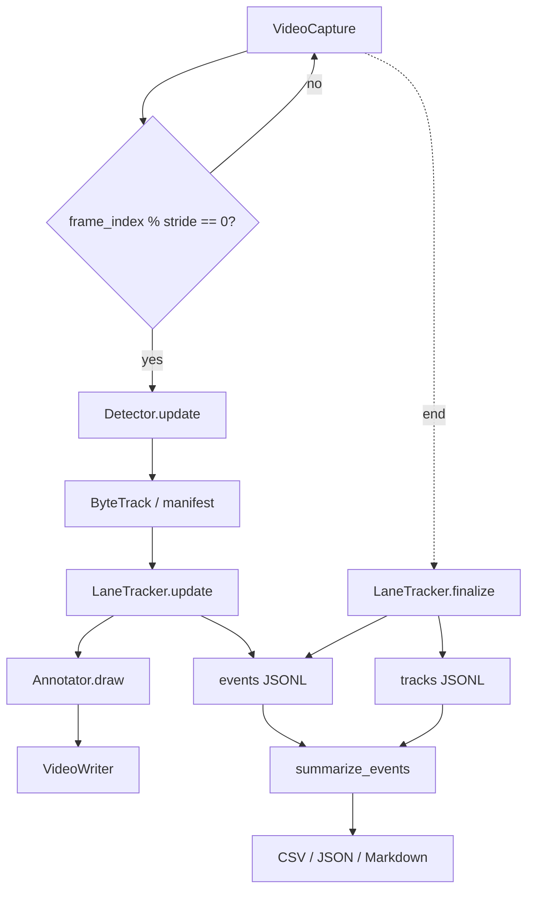

# Architecture

## Purpose

The pipeline turns a highway video into three related artifacts:

1. an annotated video showing what the system understood,
2. a stream of structured lane events,
3. per-track occupancy summaries and aggregate reports.

It is a prototype, not an enforcement system. Lane assignment and hogging indications are
heuristic and depend on correctly calibrated lane polygons.

## Pipeline



### 1. Frame sampling

`video.frame_stride` controls how many source frames are skipped. The default is 1
(every frame): with an ~18 fps source, skipping frames can make ByteTrack fail to
confirm a fast near-field vehicle, because an unconfirmed track is associated against
its last position and the IoU can drop below the 0.3 match threshold. Timing is always
computed from the source frame index (`frame_index / source_fps`), so a stride of 2 or 3
does not change dwell durations - only how early a fast vehicle is confirmed.

### 2. Detection and tracking

`YoloByteTrackDetector` wraps Ultralytics `model.track(..., persist=True)` with
`bytetrack.yaml`. It filters to the configured COCO classes (default `car`, `bus`,
`truck`) and returns `TrackedObject` observations with a run-scoped `track_id`.

The offline demo uses `ManifestDetector`, which replays a per-frame JSONL manifest through
the same interface. Analytics and annotation therefore exercise the same code path.

### 3. Coordinate spaces

| Space | Where used | Meaning |
| --- | --- | --- |
| Normalized `(x, y)` | Config lanes, rule metadata | `0.0 - 1.0` relative to frame width/height. Resolution independent. |
| Pixel `(x, y)` | Detection boxes, annotation | Absolute frame coordinates. |
| Source time `s` | Dwell, events | `frame_index / source_fps`. |

The lane tracker converts the chosen bbox anchor to normalized coordinates before testing
polygons. This keeps one configuration valid across 720p, 1080p, and 4K sources.

### 4. Lane assignment

For each detection:

1. Choose an anchor point from the bounding box:
   `center`, `bottom_center` (default), `bottom_left`, `bottom_right`, or `top_center`.
2. Optionally apply the **adaptive anchor**: when `anchor_shift_enabled` is on, a wide
   near-field box slides from the bottom-centre toward its outer bottom corner
   (bottom-left when the box centre is in the left half of the frame, bottom-right in
   the right half). The slide is linear between `anchor_shift_small_bbox_px` and
   `anchor_shift_large_bbox_px`.
3. Normalize the anchor by frame width/height.
4. Test it against every lane polygon with ray casting.
5. If more than one polygon contains the point, choose the smallest polygon by area.

`bottom_center` is usually best for perspective highway cameras because the tyres touch
the road surface, while the bbox centre can drift over a lane divider. `center` is fine
for straight top-down views. For high, oblique cameras where near-field boxes are wider
than a lane, enable the adaptive anchor.

The annotator draws the anchor as a small white dot inside each box, which makes lane
assignment errors easy to spot in the output video.

Lane-name labels are lifted into the sky, a fixed fraction of the frame height above the
horizon end of each polygon and staggered by lane index (northbound labels grow leftward,
southbound rightward), with a thin leader line down to the lane. They never sit over the
roadway or a vehicle. Object rendering uses two passes: every box first, then every label.
Vehicle label backgrounds are translucent, so a label that overlaps another box dims it
instead of hiding it.


### 5. Hysteresis

Raw point tests can flicker when a vehicle straddles a divider. The tracker therefore
keeps a **pending lane** and only commits a change after `min_lane_frames` consecutive
observations. If the vehicle returns to its current lane before the transition becomes
stable, the pending transition is cancelled and no event is emitted.

The committed stint start time is the first observation of the new lane, not the
confirmation frame. This avoids losing the time spent transitioning.

### 6. Stint lifecycle

Each track has at most one open `LaneStint`:

```text
lane_enter  ->  open stint (enter_frame, enter_time, enter_timestamp)
            ->  dwell = current_time - enter_time
lane_change ->  close old stint, open new stint, emit exit + change + enter
lane_exit   ->  close stint, record exit_time and dwell_seconds
```

Open stints are closed when:

- the vehicle changes lane,
- the track is stale for `max_track_age_frames`,
- the video ends (`finalize`).

Closing at the **last observation time** avoids inflating dwell for a vehicle that left
the frame long before the video ended.

### 7. Event ordering

For a lane change, events are emitted in this order:

```text
lane_exit (old lane, old dwell)
lane_change (from old to new, old dwell)
lane_enter (new lane, dwell 0)
```

All four event types share one JSONL stream and one schema.

### 8. Hogging evaluation

For each stable observation, rules are matched against the current lane and vehicle class.
A rule fires when:

- the lane matches by name or role,
- the class matches (empty class list means all classes),
- the vehicle is not already visibly transitioning to another lane,
- `dwell >= rule.min_dwell_seconds`,
- the `(stint, rule)` pair has not fired, or `retrigger_after_seconds` has elapsed.

`retrigger_after_seconds: 0` means one indication per track/lane stint/rule. A positive
value allows repeated indications during a long stint.

The tracker also exposes the active rule and severity to the annotator, so the box turns
red and the HUD shows `! HOGGING`.

### 9. Finalization and reports

At the end of the run:

- all open stints are closed,
- one `TrackSummary` per track is written to `tracks/<run_id>.jsonl`,
- `summarize_events` builds lane usage, lane-change, hogging, and interval aggregates,
- `write_reports` writes CSV, JSON, and Markdown artifacts.

If `evidence.enabled` is true, `evidence.py` then cuts a snapshot and an 8-second clip
(4 s before + 4 s after) around every event. Media is cut from the annotated video, so the
snapshot and clip show the box, lane label, and hogging badge. Events that share a frame
(`lane_exit` → `lane_change` → `lane_enter`) share one snapshot and one clip. The mapping is
written to `output/evidence/<run_id>/index.json`. For runs started with `--start-frame`, the
event's source time is converted to the annotated video's local time using
`start_frame / source_fps`.

### 10. Optional parallel segmented processing

The default path is a single `process_video` pass (`--workers 1`). For long clips,
`parallel.py` can optionally split the source into overlapping half-open windows and run
each one through the normal `process_video` loop in a worker process:

```text
segment k   [ start_k , start_k + segment_frames )
start_{k+1} = start_k + segment_frames - overlap_frames
```

The defaults are 12 s segments and a 3 s overlap, so starts advance every 9 s and a 30 s
block contains three segments. Worker loggers write one JSON line per processed frame
with the global `frame_index` and every tracked box. Timestamps and `video_time_s` stay
on the original video timeline, so adjacent segments can be compared frame-for-frame.

Handover runs after all workers finish, in segment order:

1. Build per-track observation lists from the overlap window
   `[start_k, min(end_{k-1}, end_k))`.
2. For every earlier/later track pair, require at least one common frame, a mean bbox IoU
   of at least `min_iou` (default 0.7), and a motion-heading cosine of at least
   `min_motion_similarity` (default 0). Heading comes from the first-to-last centre
   displacement inside the overlap; a static vehicle is treated as matching any heading.
3. Feed the allowed pairs to a pure-Python Hungarian assignment. The cost matrix pads
   unmatched rows/columns with a cost of 1.0, so a pair is accepted only when its
   combined IoU/heading score beats leaving both tracks unmatched.
4. Resolve the earlier local ID through the previous segment's mapping, so canonical IDs
   chain across every seam. Unmatched later tracks get the next fresh canonical ID.

The frame logs are merged incrementally. Frames are flushed only once no later segment
can observe them; when both sides of a seam contain the same frame, the higher-confidence
box wins. The merged log is then replayed through one global `LaneTracker` via
`process_video(observation_source=...)`, which rebuilds stints, dwell, lane changes, and
hogging events without duplicates. The annotated video, evidence, and reports are written
once from that global pass, using canonical IDs.

Each worker process keeps its YOLO model alive and calls `reset()` on the ByteTrack
adapter between segments, so weights load once per worker instead of once per segment.
Thread count is split across workers (`physical cores // workers`): on an SMT CPU the
single-pass pipeline already uses every physical core, so overlapping segments split the
same compute and can be slower. Parallel mode targets many-core CPU hosts and multi-GPU
machines; a single GPU should use `--workers 1`.

For multi-GPU hosts, pass one device id per worker (`--devices 0,1` or
`devices=["0", "1"]`). The orchestrator creates one single-worker process pool per
device and assigns segments round-robin, so each worker keeps a model resident on its
own GPU. Duplicate device ids are collapsed and the worker count is clamped to the
number of devices and segments. Without `devices`, every worker uses
`config.model.device`, which is only useful when that device is `cpu`.

The full local-to-canonical table is written to
`output/tracks/<run_id>_id_handovers.jsonl`, together with every accepted handover and
its IoU/heading scores.

## Module map

| Module | Responsibility |
| --- | --- |
| `config.py` | Typed YAML loading, lane/rule validation, run snapshot. |
| `geometry.py` | Point-in-polygon, area, centroid, lane assignment. |
| `detector.py` | YOLO + ByteTrack adapter. |
| `lane_tracker.py` | Per-track state machine for lane stints and events. |
| `hogging.py` | Rule model and severity matching. |
| `annotator.py` | Lane polygons, boxes, labels, HUD. |
| `analytics.py` | Event/track aggregation and report writing. |
| `pipeline.py` | Frame loop and artifact orchestration. |
| `parallel.py` | Segment planner, worker pool, IoU/heading handover, canonical IDs, merged replay. |
| `evidence.py` | Snapshot + 8-second clip evidence per event. |
| `demo.py` | Synthetic scene and manifest detector. |
| `recorder.py` | Chunked HLS/HTTP recording with ffmpeg. |
| `replay.py` | Paced webhook sender for precomputed events/tracks/run metadata. |
| `colab.py` | One-call Colab activation: Drive zip or live stream, then replay. |
| `cli.py` | Command-line entry points. |

## Extension points

- **Homography / perspective calibration**: replace the point-in-polygon lane mapper with
  a bird's-eye-view projection for more accurate lane geometry and speed.
- **Speed estimation**: use anchor displacement per source second in a calibrated plane.
- **Multi-camera identity**: use an external re-identification layer; `track_id` is only
  run-scoped.
- **Webhook replay sink**: `replay.py` posts batch artifacts as paced micro-batches to a local
  webhook. The receiver, Kafka, pipeline, and dashboard live in the separate pipeline project;
  this repository only sends. See `docs/HANDOFF_DATA_PIPELINE_DASHBOARD.md`.
- **Rule engine**: add relative-speed or vehicle-length conditions to `HoggingRule`.

## Known failure modes

| Symptom | Likely cause | Mitigation |
| --- | --- | --- |
| `lane n/a` labels | Anchor outside every polygon | Expand polygons, check anchor, preview lanes. |
| Too many lane changes | Polygons overlap or boundary flicker | Increase `min_lane_frames`, add a divider gap. |
| No hogging events | Rule role/lane names mismatch | Check `lanes[].role` and `lane_roles`, lower threshold. |
| Hogging on normal usage | Threshold too low or wrong role | Review road rules and raise the threshold. |
| Short dwell durations | Track ID switched or vehicle occluded | Improve detection size/confidence, review footage. |
| First box ~0.5-1 s late on a fast near-field vehicle | `frame_stride > 1`; ByteTrack matches unconfirmed tracks against their last position and can miss across large motion | Keep `frame_stride: 1`, or lower it for latency-sensitive runs. |
| Slow CPU run | Full-resolution YOLO on every frame | Use stride 2-3, `imgsz: 480`, `--no-video`. |
| Parallel mode slower than single pass | One pass already saturates physical cores; overlap adds work | Use `--workers 1` on small CPUs; keep workers for many-core hosts. |
| ID changes at a seam | Mean IoU or heading gate rejected the handover | Increase `overlap_seconds`, keep `frame_stride: 1`, or lower the IoU gate in code. |
| Duplicate events in parallel output | Should not happen; events are rebuilt from the merged log | Check `output/tracks/<run_id>_id_handovers.jsonl` and the merged frame count in `summary.json`. |
